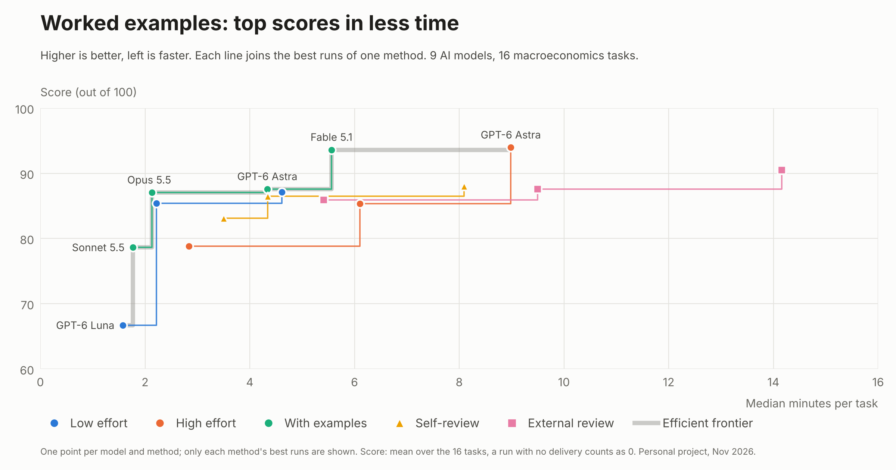

# AI agents on macroeconomics work: methods, not just models

> **Disclaimer.** This is a personal project. It is not related to my employer, which bears no responsibility for it. The views, and any errors, are my own.

Most AI comparisons ask which model is best. This benchmark asks a different question: **for a given amount of time, which way of running a model gives the best work?**

I took 16 tasks from my own work as a euro-area economist and ran each one with nine AI models and five methods: 720 deliveries. A delivery is the set of charts, tables and text the agent hands back. Every delivery was scored out of 100 and every run was timed. The analysis looks at the efficient frontier: the best score available for each amount of time.

This repository holds the **method and the results**: task definitions, the five methods, the full scoring rubrics and code, the answer keys and gold standards, the judge validation, the per-delivery scores and the code for the figure. It does **not** hold the raw agent runs (deliveries, transcripts, downloaded data).



*One point per model and method; each line joins one method's best runs; grey is the overall frontier. Score: mean over the 16 tasks, a run with no delivery counts as 0. Time: median minutes per task. Portuguese version: [results/frontier-pt.png](results/frontier-pt.png).*

## Findings

Evidence first (all reproducible from [`results/deliveries.csv`](results/deliveries.csv) with [`analysis/frontier.py`](analysis/frontier.py)), then interpretation.

**1. The frontier is made of methods.** From about 2 to 6 minutes per task every frontier point is a run with worked examples. Low effort holds only the cheapest point (GPT-6 Luna, 66.7 at 1.6 min), high effort only the top (GPT-6 Astra, 94.0 at 9.0 min). Neither review method is on the all-task frontier.

**2. Worked examples are the best value.** They hold four of the six frontier points and reach 93.6 in a median 5.6 minutes (Fable 5.1). They add almost no running time over low effort (+0.7 min per task pooled over models). The gain is not uniform: two of the nine models score lower with examples.

**3. More effort did not earn its extra time across the 16 tasks.** High effort's top point is +0.4 points above the examples top point on the same tasks, 90% interval [−1.0, +1.8] (paired bootstrap over tasks, stratified by simple/complex), and it arrives 3.4 minutes later (about 60% more time). On the 11 simple tasks alone high effort does win: +2.8 [+0.4, +5.4]. High effort also fails most often: 16 of 144 runs delivered nothing, mostly timeouts, against 3 for low effort and 1 for examples.

**4. Examples beat review.** Every self-review and external-review frontier point sits below the examples line: 1 to 7 points lower at the same time, or the same score 1.4 to 8.6 minutes later. Exception: on the 5 complex questions alone, self-review reaches the frontier. Review was applied only to the low-effort output, so review on top of examples was not tested.

**5. Measurement matters.** With 16 tasks, steps of less than about two points along the frontier are within noise. The judge was validated against my own blind labels (Cohen's κ 0.79, 95% CI 0.59–0.93, 265 questions), that check found a real bias (credit for numbers a chart did not print), and a blind recheck removed it without changing the frontier. See [docs/judge-validation.md](docs/judge-validation.md).

**Interpretation.** The method decides whether you are on the frontier; the model decides where on it. From the cheapest frontier point to the top the score rises 27 points, about 85% of it from moving to a stronger model and about 15% from changing method, almost all in the first step from low effort to examples.

## Design in one table

| | |
|---|---|
| Tasks | 16: 11 data-release write-ups (15-minute limit) and 5 analytical questions (60-minute limit). [docs/tasks.md](docs/tasks.md) |
| Models | 9 from four labs, each run as a coding agent through its own CLI: Opus 5.5, Sonnet 5.5, Haiku 5.5, Fable 5.1 (Claude Code); GPT-6 Astra, GPT-6 Luna, GPT-6.1 Sol (Codex); Grok 4.7 (Grok CLI); Kimi k3.1-pro (Kimi Code) |
| Methods | low effort, high effort, with worked examples, self-review, external review. [docs/methods.md](docs/methods.md) |
| Runs | one per model × task × method (720); runs were not repeated or cherry-picked |
| Score | 100 points per delivery: closed questions answered by a judge model + numbers checked in code against the official data. [docs/scoring.md](docs/scoring.md) |
| Judge | Jev (TypeSafe), a decision model outside the tested pool that can only pick one of the options defined in the rubric |
| Time | wall-clock minutes to completion; for review methods, first run + review |
| Cost | not measured: every run used a CLI subscription |

## Repository map

| Path | What it holds |
|---|---|
| [`docs/`](docs/) | Tasks, methods, scoring rules, judge validation, limitations |
| [`results/`](results/) | `deliveries.csv` (720 rows: score parts and minutes per delivery), `model-method-summary.csv` (means with bootstrap intervals and ranks), figures |
| [`analysis/`](analysis/) | `frontier.py` (frontiers and paired comparisons), `figure.py` (the chart) |
| [`scoring/visual-rubric-v1/`](scoring/visual-rubric-v1/) | Simple-task rubric, judge adapter, numeric code check, per-question judge answers and scores |
| [`scoring/c-rubric-v1/`](scoring/c-rubric-v1/) | Complex-task rubric, gold standards (`gold/`), keys, per-question answers and scores |
| [`scoring/answer-keys/`](scoring/answer-keys/) | Answer keys for the simple tasks, built from the official files the agents downloaded, plus the seasonal-adjustment test |
| [`scoring/scoreboard-v1/`](scoring/scoreboard-v1/) | Script that joins scores and run times into the tables in `results/` |
| [`judge-validation/`](judge-validation/) | Hand labels, agreement and κ, judge repeat variance |

The scoring code is published for transparency. It reads the agents' deliveries, which are not in this repository, so it does not run end to end from here; `analysis/` does. Files named `NOTES.md` are the working logs kept while scoring, lightly edited; they record every rule change and why.

## Reproduce the frontier

```
pip install matplotlib
python analysis/frontier.py     # frontiers for all, simple and complex tasks, and the paired comparisons
python analysis/figure.py       # writes results/frontier-en.png and frontier-pt.png
```

## Data sources

Answer keys and gold standards are computed from official statistics downloaded by the agents during their runs: Eurostat, Destatis, Deutsche Bundesbank, European Central Bank, Office for National Statistics, INE (Spain), ISTAT, INSEE, SECO, Statistics Norway and Statistics Sweden. Only derived values are stored here (latest-period rates and levels, mean revisions, a pass-through estimate), with the source and release stamp. No paid data was used. Source data © the respective institutions, reused under their open-data terms.

## Limits

16 tasks, one run per cell, five complex questions, my tasks only. Each frontier line shows a method's best models; review started from the low-effort run; the worked examples were made with earlier AI models and it was not tested whether that favours any lab. Full list: [docs/limitations.md](docs/limitations.md).

## Licence

Code: MIT. Text, figures and result tables: CC BY 4.0. See [LICENSE](LICENSE).
